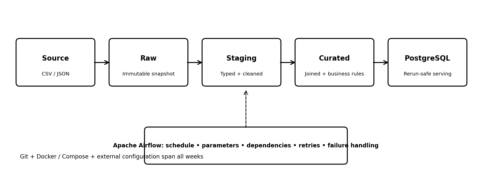

# DSS150P Laboratory 3: Productionizing a Modular Data Pipeline

**Student:** Claudia González Martín · **Course:** DSS150P Fundamentals of Data Engineering

A modular sales pipeline that takes three source files (customers CSV, products JSON, orders CSV) through
**raw → staging → curated**, loads the result into PostgreSQL with a rerun-safe UPSERT, benchmarks four storage
formats, and runs end to end as an Apache Airflow DAG with parameters, retries and failure handling.



| Goal | What was built | Where |
|---|---|---|
| 1. Reproducible environment | `.env.example`, `.gitignore`, Docker Compose services, external config in `config/settings.yml`, a CLI with one command per step | `src/cli.py`, `src/config.py` |
| 2. ETL raw → staging → curated | Run-specific raw snapshots, typed and deduplicated staging, curated join with amounts, quarantine with reasons, audit columns, UPSERT load | `src/extract`, `src/transform`, `src/load`, `src/validate` |
| 3. Storage and partitioning | CSV vs JSON Lines vs Parquet vs PostgreSQL benchmark, Parquet partitioned by year/month, load of one selected partition | `src/benchmark/storage.py`, `docs/benchmark_results.csv` |
| 4. Orchestration | Airflow DAG `dss150p_sales_pipeline` with working parameters, retries, timeouts, failure/retry callbacks | `dags/dss150p_pipeline.py` |

Evidence of every run is in **[docs/RUN_EVIDENCE.md](docs/RUN_EVIDENCE.md)**.

---

## 1. Setup from a clean checkout

Requirements: Git, Docker Desktop (or Docker Engine + Compose v2). Python 3.11 is only needed for host-side runs.

```bash
git clone https://github.com/100496356/dss150p-lab3-martin-claudia.git
cd dss150p-lab3-martin-claudia
cp .env.example .env            # Windows PowerShell: Copy-Item .env.example .env
# Linux only: put your user id in .env so Airflow can write logs -> AIRFLOW_UID=$(id -u)
```

Start PostgreSQL. The scripts in `sql/init/` create the `dss150p` and `airflow` databases and the
`staging`, `curated` and `audit` schemas the first time the volume is created:

```bash
docker compose up -d postgres
docker compose run --rm pipeline python -m src.cli validate-env
```

`validate-env` prints the project root, the database host and the tables it can see. If you change the init
scripts, recreate the volume with `docker compose down -v`.

**Optional host-side setup** (to run the CLI and tests without Docker):

```bash
python -m venv .venv
# Windows: .venv\Scripts\activate    macOS/Linux: source .venv/bin/activate
pip install -r requirements.txt
python -m src.cli validate-env      # uses POSTGRES_HOST=localhost from .env
```

## 2. Running the pipeline (CLI)

Each command calls exactly one module, so the orchestration logic stays thin. Run them inside Docker with
`docker compose run --rm pipeline <command>` or on the host with the virtual environment active.

| Command | What it does |
|---|---|
| `python -m src.cli extract` | Copies the source files into `data/raw/run_id=<id>/` (sources are never modified) and opens a row in `audit.pipeline_runs` |
| `python -m src.cli transform` | Builds staging and curated Parquet files, writes the quarantine CSV and the year/month partitioned Parquet dataset |
| `python -m src.cli load` | UPSERTs every curated row into `curated.sales_order_lines` |
| `python -m src.cli load-partition --year 2026 --month 1` | Reads only that partition folder, UPSERTs it and records it in `audit.partition_loads` |
| `python -m src.cli validate [--mode partition --year Y --month M]` | Runs the data quality checks and compares row counts with PostgreSQL; exits with code 1 on any error |
| `python -m src.cli benchmark --repeats 5` | Runs the storage benchmark and the partition benchmark |
| `python -m src.cli run-all` | extract → transform → load → validate in one go |

All steps after `extract` use the same run id: the value of `PIPELINE_RUN_ID` if it is set (Airflow sets it),
otherwise the id of the latest extract.

## 3. Design decisions

**Raw layer.** Every run copies the sources into its own folder, so a run can always be reproduced and a retry
never reads half-written files.

**Staging rules** (`src/transform/staging.py`):
- Deduplicate customers, products and orders by business key, keeping the version with the greatest `updated_at`.
- Parse all timestamps as UTC.
- Emails trimmed and lower-cased (empty → NULL), cities and tiers trimmed and title-cased.
- `product.category` flattened into `category` and `department`.
- Orders: quantity must be 1–20, status must be in the allowed list (from `config/settings.yml`), unit price > 0, discount between 0 and 1.
- Every staging row gets `pipeline_run_id` and `staged_at_utc`.

**Quarantine instead of dropping.** Invalid or orphan records are written to `data/quarantine/` with the entity,
business key, reason, the full raw record and the run id. The real dataset produced 104 quarantined records:

| Entity | Reason | Rows |
|---|---|---|
| product | invalid_unit_price (negative price) | 1 |
| order | product_quarantined_invalid_price (orders of that product) | 99 |
| order | invalid_quantity | 1 |
| order | invalid_status | 1 |
| order | orphan_customer | 1 |
| order | orphan_product | 1 |

Row counts: 50,005 raw orders → 49,998 after deduplication → **49,897 curated** (+ 1 product quarantined).
Customers: 3,003 → 3,000. Products: 601 → 600 → 599 valid.

**Curated layer.** Orders are joined with customers and products, and `gross_amount`, `discount_amount`
and `net_amount` are computed. `record_hash` is a SHA-256 of the business columns only (not the audit columns),
so an unchanged record keeps the same hash on every run.

**Rerun-safe load.** Rows are copied into a temporary table with `COPY`, then
`INSERT ... ON CONFLICT (order_id) DO UPDATE ... WHERE record_hash IS DISTINCT FROM EXCLUDED.record_hash`.
A rerun with the same data affects **0 rows** and never creates duplicates; a changed record is updated in place.

**Validation.** `order_id` unique and not null, quantity in range, no negative amounts,
`net = gross − discount`, allowed statuses only, audit fields present, and PostgreSQL row count ≥ curated rows.

## 4. Storage comparison and partitioning

Same 49,897 curated rows written in each format, 5 repetitions, **median** times reported.
Filtered read = only orders with status `DELIVERED`.

| Storage | Size | Write (s) | Full read (s) | Filtered read (s) |
|---|---|---|---|---|
| CSV | 14.5 MB | 1.121 | 0.214 | 0.212 |
| JSON Lines | 31.2 MB | 0.858 | 0.682 | 0.676 |
| **Parquet** | **5.5 MB** | **0.098** | **0.064** | **0.031** |
| PostgreSQL | 14.2 MB (table + TOAST) | 1.271 (COPY) | 0.341 | 0.063 |

Parquet is the smallest (2.6× smaller than CSV, 5.7× smaller than JSON) and the fastest to write and read,
because it is columnar, compressed and typed. JSON Lines is the worst because it repeats every key name on
every line. PostgreSQL is slower for full reads (network protocol), but filtered queries are fast and it is
the only option that supports concurrent updates, constraints and UPSERT, so it is the right serving layer
while Parquet is the right analytical file format.

**Partitioning.** `transform` also writes `data/partitioned/sales_order_lines/order_year=YYYY/order_month=MM/`.
Reading one month (2025-05, 2,540 rows) from the partitioned dataset reads **346 KB in 0.0075 s**,
versus **5.5 MB in 0.0577 s** when filtering the single Parquet file, about 7.7× faster.

**Selected-partition load.** `load-partition --year 2026 --month 1` loaded only 2,506 rows and recorded
`order_year=2026/order_month=01` in `audit.partition_loads`. Verification query:

```sql
SELECT count(*) FROM curated.sales_order_lines
WHERE order_timestamp >= '2026-01-01T00:00:00Z' AND order_timestamp < '2026-02-01T00:00:00Z';  -- 2506
SELECT * FROM audit.partition_loads;
```

Full results: [docs/benchmark_results.csv](docs/benchmark_results.csv), [docs/partition_benchmark_results.csv](docs/partition_benchmark_results.csv).

## 5. Airflow orchestration

```bash
docker compose -f docker-compose.yml -f docker-compose.airflow.yml up airflow-init
docker compose -f docker-compose.yml -f docker-compose.airflow.yml up -d airflow-webserver airflow-scheduler
```

Open http://localhost:8080 (training credentials admin / admin), unpause `dss150p_sales_pipeline`
and use **Trigger DAG w/ config**.

- **Tasks:** `extract >> transform >> load >> validate`, all sharing one `PIPELINE_RUN_ID` = the Airflow run id.
- **Schedule:** `0 2 * * *` (daily 02:00 UTC), `catchup=False`, `max_active_runs=1`.
- **Reliability:** `retries=2`, `retry_delay=30s`, `execution_timeout=10 min`.
- **Callbacks:** `on_retry_callback` and `on_failure_callback` write a JSON line to `data/runs/airflow_events.jsonl`; on final failure the run is marked `FAILED` in `audit.pipeline_runs`.

**Parameters** (all used by the tasks):

| Param | Values | Effect |
|---|---|---|
| `run_mode` | `full` / `partition` | `full` → `load` + full validation; `partition` → `load-partition` + partition validation |
| `year`, `month` | e.g. 2026, 1 | Partition to load and validate when `run_mode = partition` |
| `fail_task` | `none` / `extract` / `transform` / `load` / `validate` | Step where a deliberate failure is injected |
| `failure_mode` | `none` / `once` / `always` | `once` fails only the first try (recovers on retry); `always` fails every try |

Example configs:

```json
{"run_mode": "partition", "year": 2026, "month": 1}
{"run_mode": "full"}
{"run_mode": "full", "fail_task": "transform", "failure_mode": "once"}
{"run_mode": "full", "fail_task": "load", "failure_mode": "always"}
```

Equivalent CLI: `airflow dags trigger dss150p_sales_pipeline -r <run_id> -c '{"run_mode": "full"}'`.

Results of the successful, partition, rerun, retried, failed and recovered runs are in
[docs/RUN_EVIDENCE.md](docs/RUN_EVIDENCE.md).

## 6. Tests

```bash
pip install -r requirements.txt
python -m pytest -v
```

17 tests, all passing:
- **Transformations** (`tests/test_transform_rules.py`): deduplication keeps the latest version, UTC parsing,
  email/city normalization, category flattening, invalid orders quarantined with the right reason, curated
  amounts and orphan handling, stable `record_hash`, partition columns.
- **Validation** (`tests/test_validation.py`): clean data passes; duplicate/null ids, quantity, status, negative
  amounts, missing audit fields and empty datasets are detected.
- **Rerun-safe loading** (`tests/test_rerun_safe_load.py`, uses PostgreSQL and is skipped automatically if it
  is not reachable): a rerun inserts/updates 0 rows, a changed record is updated not duplicated, a partition load
  only loads the selected month, an invalid month is rejected.

## 7. Repository layout

```
config/settings.yml        pipeline paths, benchmark and quality rules
dags/dss150p_pipeline.py   Airflow DAG
docs/                      architecture, data dictionary, benchmark results, run evidence
sql/init/                  database and schema creation
src/cli.py                 one command per pipeline step
src/extract|transform|validate|load|benchmark|common/
tests/                     pytest suite
data/source/               immutable inputs (everything else under data/ is generated and git-ignored)
```
